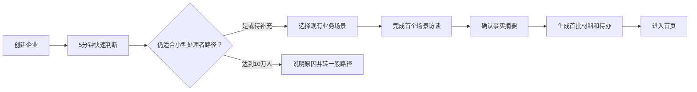
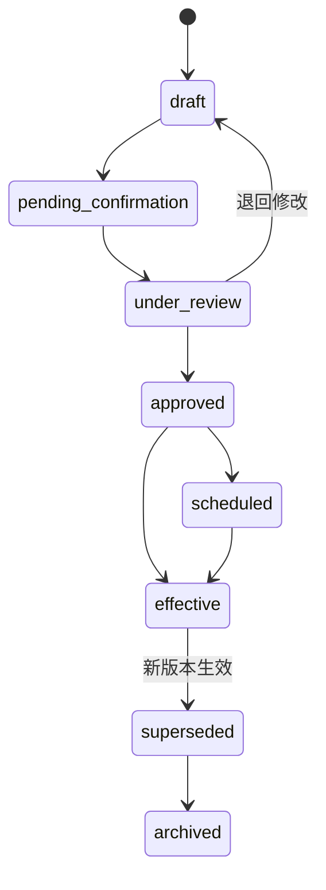

# 关键页面原型与交互说明 V1.0

> 状态：开发基线草案  
> 编制日期：2026-08-08  
> 目标用户：没有专职个保团队的小型处理者负责人、行政、人事、运营和兼职法务

## 1. 体验目标

产品不是法规知识库，也不是以聊天为中心的 AI 工具。普通用户进入平台后，应始终知道：

1. 我们现在处于什么状态；
2. 今天需要做什么；
3. 为什么问这个问题；
4. 系统目前怎样理解我们的业务；
5. 哪些内容还不能确定；
6. 完成后能得到什么材料和证明。

首期核心体验指标：

- 5 分钟内完成快速企业画像；
- 15 分钟内完成一个普通 B2B 联系人或官网联系场景；
- 已知事实不重复询问；
- 每屏最多 3—5 个主要问题；
- 用户可以选择“不清楚”，系统明确告诉他向谁确认；
- AI 提取结果必须以“请确认”的形式出现；
- 正式发布、签字和整改完成均有明确人工确认点。

## 2. 信息架构

首期主导航固定为五项：

```text
首页｜我的业务｜合规材料｜办理事项｜记录与导出
```

右上角提供：企业切换（后置）、帮助、通知、账户。

| 导航 | 用户理解 | 主要内容 |
|---|---|---|
| 首页 | 今天要做什么 | 状态、待办、变化入口、快速操作 |
| 我的业务 | 我们怎样使用信息 | 个人类别、业务场景、系统、合作方、境外访问 |
| 合规材料 | 我们有哪些正式材料 | 隐私声明、内部要求、官方自查表、PIPIA、合规码 |
| 办理事项 | 有哪些工作未完成 | 整改、权利请求、安全事件、复核 |
| 记录与导出 | 如何证明做过 | 评估、版本、证据、签字实例、检查材料包 |

不单独设置“AI 中心”“Dify 工作流”或“知识库”菜单。

## 3. 首次进入流程



### 3.1 欢迎页

```text
用简单步骤建立贵单位的个人信息保护档案

您将完成：
✓ 判断是否适合小型处理者简化路径
✓ 说明贵单位实际处理哪些个人信息
✓ 生成需要的材料和待办

预计 5 分钟完成快速建档，之后可随时继续完善。

[开始建档]
```

避免使用“全面合规”“认证通过”“零风险”等表述。

### 3.2 快速判断页面

页面采用单列卡片，每屏 3—4 题。顶部显示“第 1/3 步”和预计时间。

```text
第 1 步：先了解贵单位

贵单位的主要业务面向谁？
( ) 主要面向企业
( ) 主要面向个人
( ) 两者都有
( ) 主要是内部员工管理

贵单位是否为外商投资企业或外国企业在华分支？
( ) 外商投资企业
( ) 外国企业在华分支
( ) 不是
( ) 不清楚

说明：外资身份不会自动判断为数据出境，我们后面会询问实际系统和访问情况。

[保存并继续]
```

### 3.3 人数问题

不直接只放一个数字框，应先解释计数口径：

```text
目前仍保存或使用的个人信息，大约涉及多少位不同的自然人？

请合并计算：员工、招聘候选人、客户/供应商联系人、消费者和访客。
不要填写客户企业数量；已经删除的信息不计入。

[ 精确数字 ] 或 [ 选择区间 ▼ ]
[ ] 我暂时不清楚，需要向 IT 或业务人员确认
```

达到 10 万人时不继续给出小型处理者正式结论，但允许用户保存已填信息和下载转专业服务说明。

## 4. 首页

首页只展示状态、待办和高频动作，不展示法规新闻流或复杂风险仪表盘。

```text
早上好，上海示例科技有限公司

当前状态：基础档案待完善
适用路径：小型个人信息处理者（人数统计待确认）

┌ 今天需要处理 ─────────────────────────┐
│ 1. 确认全球 CRM 的数据存储地         [去确认] │
│ 2. 完善 B2B 联系人保存期限            [继续] │
│ 3. 审核《B2B 联系人隐私告知》草稿      [查看] │
└─────────────────────────────────────┘

常用操作
[业务有变化] [收到个人申请] [发生安全事件] [下载检查材料]

最近完成
✓ 员工管理场景已确认
✓ 影响评估 P01 已签字归档
```

状态优先使用普通语言：

- “还差 3 项需要确认”，而不是“合规成熟度 62 分”；
- “需要向 IT 确认”，而不是“事实置信度不足”；
- “建议专业人员复核”，而不是“红色风险命中”。

## 5. 我的业务

### 5.1 概览页

分为四张卡片：

```text
涉及哪些人                  业务场景
员工 86 人                  招聘与候选人管理
候选人约 300 人              员工管理
客户联系人约 2,300 人        B2B 客户联系人管理
[管理]                      [新增业务]

使用的系统                  合作方与境外访问
本地薪酬系统                 短信服务商 1 家
集团 CRM（存储地待确认）      境外访问：待确认
[管理]                      [查看]
```

卡片首先显示用户熟悉的业务名称，不以“处理活动”“数据主体”等法律术语作为标题。

### 5.2 业务场景详情

```text
B2B 客户联系人管理                    状态：还差 2 项确认

用途          项目交付、客户关系管理、产品营销
涉及人员      客户和供应商联系人，约 2,300 人
信息          姓名、公司、职位、工作邮箱、电话、沟通记录
使用系统      集团 CRM、企业邮箱
合作方        CRM 供应商、集团亚太销售运营团队
保存规则      项目结束后 2 年；营销拒绝后停止联系
相关声明      B2B 联系人隐私告知 v1.1（草稿）

[继续完善] [业务发生变化] [查看事实记录] [开始评估]
```

“业务发生变化”不修改历史事实，而是创建变化会话：先列出现状，让用户只修改变化部分，再显示受影响的文档、评估和待办。

### 5.3 系统详情

系统详情采用表格而不是开放描述：

| 项目 | 示例 |
|---|---|
| 系统 | 集团 CRM |
| 提供商 | XXX Software Ltd. |
| 存储地 | 待 IT 确认 |
| 备份地 | 不清楚 |
| 可访问地区 | 中国、亚太销售团队（新加坡） |
| 涉及信息 | 客户联系人、项目沟通记录 |
| 删除能力 | 供应商管理员人工处理 |
| 合同 | 集团框架协议 v3 |

对“不清楚”提供直接操作：[创建给 IT 的确认清单]。

## 6. 场景访谈页面

桌面端采用“步骤＋问题＋当前理解”三部分，但中间问题区保持最宽。

```text
┌ 步骤 ─────────┬ 本轮问题 ──────────────────┬ 当前理解 ─────────┐
│ ✓ 基本情况     │ 联系人信息会进入哪些系统？ │ 人员：客户联系人   │
│ ✓ 涉及人员     │ [✓] CRM                   │ 用途：项目交付     │
│ ● 系统与合作方 │ [✓] 企业邮箱              │ 信息：姓名、邮箱   │
│ ○ 保存与删除   │ [ ] 邮件营销              │ 系统：2 个         │
│ ○ 确认摘要     │ [+ 添加其他系统]          │ 待确认：存储地     │
│                │                           │ [查看全部]         │
└────────────────┴───────────────────────────┴────────────────────┘
```

移动端改为单列，当前理解收起为顶部“已确认 12 项、待确认 2 项”。

### 6.1 AI 提取的展示

上传隐私声明或系统清单后，不显示“AI 已判断”，而显示：

```text
我们从《员工隐私告知 v2》发现以下内容，请确认：

□ 员工信息会进入集团 HR 系统
□ 保存地点写为“中国及集团运营地区”
□ 文档没有说明具体保存期限

[全部正确] [逐项修改] [暂不采用]
```

确认前均为候选事实。

### 6.2 事实冲突

```text
发现一处需要确认

您刚才回答“客户联系人信息不向境外提供”，
但集团 CRM 显示新加坡团队可以远程查看。

实际情况是：
( ) 新加坡团队确实可以查看
( ) 只能查看企业信息，不能查看联系人信息
( ) 目前不清楚，需要向 IT 确认
```

系统不得自行选择第一项。

## 7. 事实摘要确认页

确认页按照用户可理解的章节展示：业务、人员、信息、目的、系统和人员、保存和删除、告知与权利、尚待确认。

每行提供“修改”按钮，底部显示：

```text
[ ] 我已核对以上情况，确认它们可以作为本次评估依据。

[确认并开始评估]
```

有阻断事实时改为：

```text
暂时不能开始正式评估

还需确认：集团 CRM 存储地、境外管理员范围。
[生成确认清单] [保存稍后继续]
```

## 8. 合规材料

### 8.1 材料首页

按“对外材料、内部材料、官方表单”分组：

```text
对外材料
隐私声明与告知  3 份     合规公开页  1 个

内部材料
个人信息保护内部要求      安全事件应急要求

官方表单
合规审计自查表：进行中 18/24
影响评估表：已完成 2 份
```

### 8.2 隐私声明列表

```text
文档                           当前状态          适用范围
《网站隐私声明》                v2.0 已生效       官网联系表单
《员工个人信息告知》            v1.3 已生效       员工管理
《B2B 联系人隐私告知》          v1.1 待确认       客户/供应商联系人
```

每份文档只突出三个入口：[查看当前版本] [准备新版本] [查看历史]。

## 9. 隐私声明版本管理

### 9.1 版本详情

```text
《B2B 联系人隐私告知》

当前有效：v1.0，自 2026-09-01 生效
准备中的版本：v1.1，待业务负责人确认

v1.1 为什么需要修改
• 新增集团 CRM 作为使用系统
• 新增新加坡区域团队远程访问
• 将保存期限从“不超过必要期限”明确为“项目结束后 2 年”

[查看修改内容] [确认业务事实] [提交审核]
```

### 9.2 版本对比

对比页分两层：

1. 文本变化：新增、删除、修改的段落；
2. 业务影响：新增数据字段、目的、系统、接收方、保存期限和个人权利变化。

```text
业务影响变化

+ 使用系统：集团 CRM
+ 境外访问：新加坡亚太销售运营团队
~ 保存期限：未明确 → 项目结束后 2 年
! 需要确认：境外接收方完整法定名称
```

只有文本变化而没有对应事实变化时，提示用户确认是否只是措辞调整。

### 9.3 发布流程



发布确认框必须显示：生效时间、适用范围、将替代的版本、发布渠道和待保存的发布证据。正式生效版本不能编辑；“恢复旧版”会创建内容相同但版本号和生效时间不同的新版本。

## 10. 官方审计自查表

用户操作按六组展示，但导出保持官方 1—24 顺序：

1. 收集、使用和告知；
2. 合作方、自动化和公开；
3. 敏感、未成年人和境外；
4. 删除和个人权利；
5. 内部制度、技术、培训和负责人；
6. 影响评估和安全事件。

每项页面：

```text
事项 5：委托处理

系统已根据企业情况带入：
• 使用 3 家云服务商
• 已上传 2 份合同
• 尚无服务商定期检查记录

当前建议：不合规（待负责人确认）
原因：尚未证明对受托人的处理活动进行监督。

整改任务
[ ] 制定年度供应商检查清单
[ ] 完成第一轮检查并上传记录

[查看官方原文] [查看依据和证据] [确认结论]
```

官方结论只能由获授权人员确认。选择“不适用”必须填写理由；选择“不合规”必须生成整改说明。

## 11. 影响评估表

先显示五类情形及适用状态：

```text
✓ 处理敏感个人信息             需要评估
— 利用个人信息进行自动化决策   不适用
✓ 委托、提供或公开             需要评估
? 向境外提供                   等待确认系统存储地
— 其他重大影响活动             暂未发现
```

进入具体情形后使用三步：

1. 目的和方式是否合理且必要；
2. 对个人的影响和安全风险；
3. 已采取的保护措施是否足够。

第二步不得在官方输出层增加“无影响”选项。若用户认为没有影响，系统提示说明原因并转复核，避免错误映射为“不适用”。

## 12. 办理事项

列表按用户工作分类，而不是按法规类型：

```text
需要我确认（3）｜需要补材料（2）｜整改中（4）｜等待他人（1）｜已完成
```

任务卡只显示：做什么、为什么、负责人、期限、完成标准和一个主按钮。

```text
确认集团 CRM 的数据存储地
为什么：决定是否需要进入境外提供影响评估
负责人：IT 王经理
期限：8 月 15 日
完成标准：填写主要和备份存储国家，上传供应商说明或邮件确认

[填写结果]
```

“标记完成”后仍需按任务配置决定是否由合规负责人验收。

## 13. 记录与导出

### 13.1 合规时间线

```text
2026-09-30  影响评估 P01 签字归档
2026-09-28  《员工个人信息告知》v1.3 生效
2026-09-25  完成集团 HR 系统访问范围确认
2026-09-20  员工管理事实快照已确认
```

### 13.2 检查材料包

用户选择范围和基准日后，系统预览：

- 企业基本情况；
- 当前处理活动和人数说明；
- 当前有效隐私声明及发布证据；
- 官方审计自查表；
- 已触发的影响评估表；
- 整改和完成证据；
- 培训、权限检查和应急材料；
- 版本与签字清单。

导出前显示缺失项，但允许用户导出“草稿材料包”，文件须带明显草稿标记。

## 14. 个人权利请求入口

对外入口统一称“个人信息相关请求”，适用于消费者、员工和 B2B 联系人。表单只收最少信息：请求类型、涉及业务、联系信息、必要身份核验材料。

企业后台处理流程：收到 → 核验 → 查找涉及系统 → 执行 → 复核 → 回复 → 归档。平台不能仅把工单状态改为“完成”，必须记录实际在哪些系统执行及证明。

## 15. 安全事件快捷入口

首页“发生安全事件”按钮始终可见，进入后先提供紧急动作：限制账号、联系系统服务商、保留日志和证据，再询问事件细节。严重事件提示转专业人员；向部门或个人发送通知必须人工确认。

## 16. 文案规范

| 避免 | 推荐 |
|---|---|
| 数据主体 | 相关个人、员工、联系人或消费者 |
| 处理活动 | 这项业务怎样使用个人信息 |
| 控制者/处理者 | 谁决定为什么收集和怎样使用 |
| 数据出境 | 境外存储、传输或远程查看 |
| 不适用 | 贵单位目前没有这种情况 |
| 风险命中 | 发现一项需要确认或完善的情况 |
| AI 结论 | 系统建议，等待负责人确认 |
| 合规认证 | 已完成哪些工作和仍待完善事项 |

## 17. 无障碍与国际化

- 不只用颜色表达状态；
- 表单键盘可操作，错误提示靠近字段；
- 正文最小字号和行距适合长文本阅读；
- 中英文文档版本分别管理、建立翻译对应关系；
- 中文官方表格为权威输出，英文可作为企业内部辅助译文；
- 日期、时区、姓名顺序和国家地区使用结构化字段。

## 18. 埋点与体验指标

只记录产品行为，不记录用户填写的原始个人信息内容：

- 快速画像完成率和耗时；
- 每个问题的“不清楚”比例；
- 每个场景的中断和恢复位置；
- AI 候选事实被接受、修改和拒绝比例；
- 事实摘要一次确认率；
- 隐私声明从草稿到生效耗时；
- 官方表单被阻断的主要原因；
- 每家企业月均人工支持时间；
- 错误放行率和高风险漏转人工率。

## 19. 页面验收门槛

1. B2B 用户无需先理解“个人信息处理活动”即可建立联系人场景；
2. 外资用户能区分企业身份与实际境外访问事实；
3. 用户选择“不清楚”后能得到具体确认清单，而不是死路；
4. 已有事实自动带入，并显示来源和确认时间；
5. 任何 AI 提取都必须经过确认；
6. 事实摘要能在一个页面内看清主要业务链路和待确认项；
7. 有效隐私声明无法直接编辑，用户能查看文本差异和业务影响差异；
8. 官方审计表导出仍保持 24 项顺序；
9. PIPIA 导出严格保持官方选项；
10. 首页不展示无行动价值的法规资讯和复杂评分；
11. 普通场景平均不超过 15 分钟，重复评估只问变化部分；
12. 所有签字、发布、导出和查看敏感证据行为均有审计记录。

