# 核心 ERD 与数据字典 V1.0

> 状态：开发基线草案  
> 编制日期：2026-08-08  
> 数据库建议：PostgreSQL 18  
> 架构建议：Spring Boot 模块化单体；Dify 通过 AI Gateway 调用，不直接访问数据库

## 1. 建模目标

数据模型必须支持：

- 多租户严格隔离；
- 企业事实持续版本化、评估时冻结快照；
- 一个企业下多个业务场景和处理活动；
- 隐私声明草稿、审核、生效、替代和发布证据；
- 官方表格模板版本、工作底稿、正式结论和签字归档；
- 问题会话暂停恢复、动态追问和事实复用；
- AI 输入输出可追溯但不能成为唯一事实源；
- 发现、整改、证据和人工复核闭环；
- 个人权利请求和安全事件基础流程。

## 2. 总体关系

```mermaid
erDiagram
    TENANT ||--|| ENTERPRISE : owns
    TENANT ||--o{ TENANT_MEMBER : has
    ENTERPRISE ||--o{ PERSON_CATEGORY : identifies
    ENTERPRISE ||--o{ PROCESSING_ACTIVITY : operates
    PROCESSING_ACTIVITY }o--o{ PERSON_CATEGORY : concerns
    PROCESSING_ACTIVITY }o--o{ DATA_FIELD : processes
    PROCESSING_ACTIVITY }o--o{ PURPOSE : serves
    PROCESSING_ACTIVITY }o--o{ INFORMATION_SYSTEM : uses
    PROCESSING_ACTIVITY }o--o{ THIRD_PARTY : involves
    PROCESSING_ACTIVITY ||--o{ CROSS_BORDER_TRANSFER : may_have

    ENTERPRISE ||--o{ FACT_RECORD : has
    FACT_SNAPSHOT ||--o{ FACT_SNAPSHOT_ITEM : contains
    FACT_RECORD ||--o{ FACT_SNAPSHOT_ITEM : frozen_as

    ENTERPRISE ||--o{ ASSESSMENT_SESSION : starts
    ASSESSMENT_SESSION ||--o{ QUESTION_RESPONSE : contains
    ASSESSMENT_SESSION ||--o| FACT_SNAPSHOT : confirms
    ASSESSMENT_SESSION ||--o{ AI_RUN : assists

    ENTERPRISE ||--o{ BUSINESS_DOCUMENT : owns
    BUSINESS_DOCUMENT ||--o{ DOCUMENT_VERSION : versions
    DOCUMENT_VERSION ||--o{ DOCUMENT_SCOPE : applies_to
    DOCUMENT_VERSION ||--o{ PUBLICATION_RECORD : published_as
    DOCUMENT_VERSION ||--o{ DOCUMENT_REVIEW : reviewed_by

    FORM_TEMPLATE ||--o{ FORM_TEMPLATE_VERSION : versions
    FORM_TEMPLATE_VERSION ||--o{ FORM_ITEM : contains
    ENTERPRISE ||--o{ FORM_INSTANCE : completes
    FORM_INSTANCE ||--o{ FORM_RESPONSE : answers
    FORM_INSTANCE ||--o{ WORKPAPER_RESPONSE : supports
    FORM_INSTANCE ||--o| SIGNATURE_SNAPSHOT : signed_by

    ENTERPRISE ||--o{ ASSESSMENT : evaluates
    ASSESSMENT ||--o{ FINDING : produces
    FINDING ||--o{ REMEDIATION_TASK : creates
    EVIDENCE }o--o{ FINDING : supports
    EVIDENCE }o--o{ FORM_RESPONSE : supports

    ENTERPRISE ||--o{ RIGHTS_REQUEST : receives
    ENTERPRISE ||--o{ SECURITY_INCIDENT : handles
```

## 3. 通用字段和约束

除只读全局模板表外，租户业务表统一包含：

| 字段 | 类型 | 规则 |
|---|---|---|
| `id` | uuid | UUIDv7，主键 |
| `tenant_id` | uuid | 非空；所有查询由服务端注入租户条件 |
| `created_at` | timestamptz | 非空，数据库默认当前时间 |
| `created_by` | uuid | 非空，系统任务使用受控 service account |
| `updated_at` | timestamptz | 非空 |
| `updated_by` | uuid | 非空 |
| `row_version` | bigint | 乐观锁 |
| `deleted_at` | timestamptz/null | 仅允许用于可删除工作数据；正式档案不得软删规避留存 |

安全约束：

- 应用层租户隔离是主控制，PostgreSQL Row Level Security 作为纵深保护；
- 任何外键关联租户业务对象时，同时校验 `tenant_id` 一致；
- 对象存储路径不使用用户文件名作为权限边界，使用租户和对象 UUID；
- 正式快照、已生效文档、已签字表单和操作日志不可更新，只能追加更正版本；
- 业务日志不得记录原始个人信息、完整文档内容或模型密钥。

## 4. 租户与主体模块

### 4.1 `tenant`

| 字段 | 类型 | 说明 |
|---|---|---|
| `id` | uuid | 主键 |
| `code` | varchar(40) | 全局唯一、不可变 |
| `name` | varchar(200) | 租户显示名称 |
| `status` | varchar(20) | `trial / active / suspended / closed` |
| `plan_code` | varchar(40) | 套餐 |
| `data_region` | varchar(40) | 数据部署区域 |
| `retention_policy_id` | uuid | 租户默认留存策略 |

索引：`unique(code)`、`index(status)`。

### 4.2 `enterprise`

| 字段 | 类型 | 说明 |
|---|---|---|
| `id` | uuid | 主键，与租户一对一首期实现 |
| `tenant_id` | uuid | 唯一 |
| `legal_name` | varchar(300) | 法定名称 |
| `credit_code` | varchar(32) | 租户内唯一 |
| `organization_type` | varchar(40) | 组织类型 |
| `ownership_type` | varchar(40) | 投资属性，仅用于事实引导 |
| `registered_region_code` | varchar(20) | 注册地区 |
| `industry_code` | varchar(40) | 行业 |
| `business_model` | varchar(20) | `B2B / B2C / both / internal_only` |
| `profile_status` | varchar(30) | `not_started / quick_profile / completing / confirmed / needs_update` |

### 4.3 `tenant_member`

| 字段 | 类型 | 说明 |
|---|---|---|
| `tenant_id` | uuid | 联合主键之一 |
| `user_id` | uuid | 联合主键之一 |
| `role_code` | varchar(40) | `owner / compliance / business / it / reviewer / readonly` |
| `status` | varchar(20) | 邀请、有效、停用 |
| `joined_at` | timestamptz | 加入时间 |

权限在后端按“角色＋对象范围＋操作”判断。Dify 不接收用户权限信息，也不执行授权。

## 5. 企业画像与处理活动模块

### 5.1 `person_category`

| 字段 | 类型 | 说明 |
|---|---|---|
| `enterprise_id` | uuid | 企业 |
| `category_code` | varchar(40) | employee、candidate、customer_contact 等 |
| `display_name` | varchar(100) | 用户名称 |
| `present` | boolean | 是否涉及 |
| `estimated_count_min` | integer | 人数下界 |
| `estimated_count_max` | integer | 人数上界 |
| `under_14_possible` | varchar(10) | yes/no/unknown |
| `sensitive_possible` | varchar(10) | yes/no/unknown |

唯一约束：`unique(tenant_id, enterprise_id, category_code)`。

### 5.2 `processing_activity`

| 字段 | 类型 | 说明 |
|---|---|---|
| `enterprise_id` | uuid | 企业 |
| `activity_code` | varchar(50) | 租户内稳定编号 |
| `name` | varchar(200) | 如“B2B 客户联系人管理” |
| `scenario_type` | varchar(50) | 场景模板编码 |
| `status` | varchar(20) | planned/active/suspended/ended |
| `owner_user_id` | uuid/null | 内部负责人 |
| `owner_name` | varchar(100) | 允许外部或未开户负责人 |
| `person_count_min` | integer | 活动人数 |
| `person_count_max` | integer | 活动人数 |
| `current_fact_snapshot_id` | uuid/null | 最近确认快照 |
| `last_confirmed_at` | timestamptz/null | 最近确认时间 |

索引：`unique(tenant_id, activity_code)`、`index(tenant_id, scenario_type, status)`。

### 5.3 `purpose`

| 字段 | 类型 | 说明 |
|---|---|---|
| `processing_activity_id` | uuid | 所属活动 |
| `name` | varchar(200) | 具体目的 |
| `description` | text | 业务说明 |
| `service_necessity` | varchar(20) | yes/no/partial/unknown |
| `alternative_available` | varchar(20) | yes/no/unknown |
| `is_marketing` | boolean | 是否营销 |
| `is_profiling` | boolean | 是否画像 |
| `is_secondary_use` | boolean | 是否二次利用 |

### 5.4 `data_field`

| 字段 | 类型 | 说明 |
|---|---|---|
| `enterprise_id` | uuid | 企业字段目录 |
| `canonical_name` | varchar(100) | 稳定名称 |
| `display_name` | varchar(100) | 用户名称 |
| `category_code` | varchar(40) | 联系、身份、就业等 |
| `is_personal_information` | varchar(10) | yes/no/unknown |
| `is_sensitive` | varchar(10) | yes/no/unknown |
| `sensitive_category` | varchar(40)/null | 敏感类别 |
| `precision_note` | varchar(200)/null | 精度，如出生月份 |

关联表：

- `activity_person_category(activity_id, person_category_id)`；
- `activity_purpose(activity_id, purpose_id)`；
- `activity_data_field(activity_id, data_field_id, required, source_code)`；
- `purpose_data_field(purpose_id, data_field_id)`。

## 6. 系统、第三方和跨境模块

### 6.1 `information_system`

| 字段 | 类型 | 说明 |
|---|---|---|
| `enterprise_id` | uuid | 企业 |
| `name` | varchar(200) | 系统名称 |
| `provider_name` | varchar(300) | 供应商 |
| `provider_country` | varchar(10) | 国家/地区代码 |
| `hosting_countries` | jsonb | 存储地，允许 unknown |
| `backup_countries` | jsonb | 备份地 |
| `admin_countries` | jsonb | 管理/远程访问地 |
| `authentication_status` | jsonb | MFA 等 |
| `encryption_status` | jsonb | 传输/存储 |
| `logging_status` | jsonb | 日志能力 |
| `deletion_capability` | varchar(30) | automatic/manual/vendor_only/unknown |
| `contract_document_version_id` | uuid/null | 合同版本 |

### 6.2 `third_party`

| 字段 | 类型 | 说明 |
|---|---|---|
| `enterprise_id` | uuid | 企业 |
| `legal_name` | varchar(300) | 第三方法定名称 |
| `product_name` | varchar(200) | 产品/服务 |
| `role_candidate` | varchar(30) | entrusted/joint/recipient/independent/unknown |
| `role_confirmed` | varchar(30)/null | 规则或人工确认结果 |
| `countries` | jsonb | 所在和访问国家 |
| `contract_document_version_id` | uuid/null | 协议 |
| `last_supervised_at` | date/null | 最近监督日期 |
| `incident_channel` | jsonb | 事件联系人和方式 |

关联表：`activity_system`、`activity_third_party`、`third_party_data_field`、`third_party_person_category`。

### 6.3 `cross_border_transfer`

| 字段 | 类型 | 说明 |
|---|---|---|
| `processing_activity_id` | uuid | 所属活动 |
| `exists_status` | varchar(10) | yes/no/unknown |
| `mode_codes` | jsonb | storage/transfer/remote_access/group_sharing 等 |
| `recipient_third_party_id` | uuid/null | 境外接收方 |
| `country_region_code` | varchar(10)/null | 国家/地区 |
| `purpose_description` | text/null | 出境目的 |
| `non_sensitive_count_ytd` | integer/null | 当年累计人数 |
| `sensitive_count_ytd` | integer/null | 当年累计敏感人数 |
| `frequency_code` | varchar(20)/null | continuous/periodic/on_demand/one_time |
| `protection_measures` | jsonb | 措施 |
| `procedure_status` | jsonb | 已完成程序事实，不直接存法律结论 |

数据库约束不能写成“外资企业必须有跨境记录”。`enterprise.ownership_type` 与 `cross_border_transfer.exists_status` 相互独立。

## 7. 事实与快照模块

### 7.1 `fact_record`

按照 [fact-schema.v1.json](C:/Software/PIPL/schemas/fact-schema.v1.json) 保存。关键数据库字段：

| 字段 | 类型 | 规则 |
|---|---|---|
| `fact_code` | varchar(100) | 受事实目录约束 |
| `subject_type` | varchar(40) | 企业、活动、系统等 |
| `subject_id` | uuid | 所属对象 |
| `value_type` | varchar(20) | 值类型 |
| `value` | jsonb | 结构化值 |
| `status` | varchar(20) | candidate/confirmed/disputed/expired/superseded |
| `source_type` | varchar(30) | 来源 |
| `source_ref` | varchar(500)/null | 来源 |
| `effective_from/to` | date | 有效区间 |
| `valid_until` | date/null | 复核时间 |
| `confirmed_by/at` | uuid/timestamptz | 确认人和时间 |
| `confidence` | numeric(4,3)/null | 仅候选事实 |
| `supersedes_fact_id` | uuid/null | 版本链 |

约束：

- `source_type = ai_inference` 时 `status = candidate`；
- `status = confirmed` 时确认人和时间非空；
- 更新已确认事实时，旧记录转为 superseded，新建记录；
- 当前有效事实索引：`(tenant_id, subject_type, subject_id, fact_code) where status='confirmed' and effective_to is null`。

### 7.2 `fact_snapshot` 和 `fact_snapshot_item`

`fact_snapshot` 保存 `as_of`、用途、内容哈希、创建人；`fact_snapshot_item` 保存快照与具体 `fact_record_id`。创建快照时只允许纳入 confirmed 事实。已被签字、发布或正式评估引用后不可删除。

## 8. 访谈与问题模块

### 8.1 `assessment_session`

| 字段 | 类型 | 说明 |
|---|---|---|
| `enterprise_id` | uuid | 企业 |
| `session_type` | varchar(50) | onboarding/scenario/audit/pipia/document_review |
| `processing_activity_id` | uuid/null | 场景 |
| `question_tree_code/version` | varchar | 固定配置版本 |
| `status` | varchar(30) | draft/in_progress/needs_input/fact_confirmation/completed/cancelled |
| `current_phase_code` | varchar(50) | 当前阶段 |
| `blocking_reasons` | jsonb | 阻断项 |
| `confirmed_fact_snapshot_id` | uuid/null | 用户确认后生成 |
| `started_at/completed_at` | timestamptz | 时间 |

### 8.2 `question_response`

| 字段 | 类型 | 说明 |
|---|---|---|
| `assessment_session_id` | uuid | 会话 |
| `question_code/version` | varchar/int | 问题版本 |
| `answer` | jsonb | 结构化答案 |
| `answer_status` | varchar(20) | answered/unknown/skipped/superseded |
| `source_type` | varchar(20) | user/import/ai_candidate |
| `answered_by/at` | uuid/timestamptz | 回答人 |
| `generated_fact_ids` | uuid[] | 由回答生成的候选事实 |

唯一约束：同一会话、问题版本当前只有一条非 superseded 回答。

## 9. 隐私声明与文档版本模块

### 9.1 `business_document`

| 字段 | 类型 | 说明 |
|---|---|---|
| `enterprise_id` | uuid | 企业 |
| `document_type` | varchar(50) | privacy_notice/employee_notice/recruitment_notice/internal_policy 等 |
| `name` | varchar(300) | 文档名称 |
| `default_language` | varchar(10) | 首期以中文为正式基线 |
| `current_effective_version_id` | uuid/null | 当前有效版本 |

### 9.2 `document_version`

| 字段 | 类型 | 说明 |
|---|---|---|
| `business_document_id` | uuid | 文档 |
| `version_number` | varchar(30) | 如 1.2 |
| `status` | varchar(30) | draft/pending_confirmation/under_review/approved/scheduled/effective/superseded/archived |
| `content_object_key` | varchar(500) | 原始文件 |
| `normalized_content` | text | 搜索/比对文本，访问受控 |
| `content_hash` | char(64) | 内容哈希 |
| `fact_snapshot_id` | uuid | 起草依据 |
| `regulation_snapshot` | jsonb | 适用法规版本 |
| `change_summary` | jsonb | 文本差异和业务影响 |
| `effective_from/to` | timestamptz | 生效区间 |
| `supersedes_version_id` | uuid/null | 替代关系 |
| `approved_by/at` | uuid/timestamptz | 批准 |

状态约束：

- `effective` 内容不可修改；
- 同一文档同一适用范围同一时点只能有一个有效版本；
- 所谓“回滚”实际创建一个以旧内容为基础的新版本；
- AI 只能生成草稿或审查建议，不能批准或生效。

### 9.3 范围、审查和发布

- `document_scope`：版本适用企业、个人类别、活动、网站、产品、门店；
- `document_review`：审查人、结论、意见、时间；
- `publication_record`：渠道、URL/位置、发布时间、撤下时间、页面/邮件/照片证据、内容哈希。

## 10. 官方表格模块

### 10.1 全局模板

`form_template`、`form_template_version`、`form_section`、`form_item` 为平台全局只读数据。模板版本保存官方来源、原文件哈希、Schema 哈希、版本号、替代关系和核验人，不根据施行日期自动切换。

### 10.2 `form_instance`

| 字段 | 类型 | 说明 |
|---|---|---|
| `enterprise_id` | uuid | 企业 |
| `template_version_id` | uuid | 固定模板版本 |
| `scope_type/scope_refs` | varchar/jsonb | 企业或场景范围 |
| `assessment_date` | date | 实际开展或确认日期，仅用于留痕 |
| `fact_snapshot_id` | uuid | 签字事实快照 |
| `document_version_refs` | uuid[] | 关联文档 |
| `ruleset_version` | varchar(40) | 规则版本 |
| `status` | varchar(30) | draft/collecting/reviewing/remediation/ready_to_sign/signed/archived |
| `retention_until` | date | 5 年或 3 年最低留存 |
| `signed_content_hash` | char(64)/null | 签字后内容哈希 |

### 10.3 响应和签字

- `form_response`：官方项目编码、官方结论、官方备注；
- `workpaper_response`：动态子问题、适用理由、分析、复核状态；
- `form_response_fact_ref`、`form_response_evidence_ref`：来源下钻；
- `signature_snapshot`：签字人、角色、声明、方式、认证信息、签署时间、内容哈希。

签字后禁止更新 `form_instance`、`form_response` 和签字关联快照，只能创建更正实例。

## 11. 评估、发现、整改和证据

### 11.1 `assessment`

| 字段 | 类型 | 说明 |
|---|---|---|
| `assessment_type` | varchar(50) | qualification/triage/notice_review/pipia/audit |
| `processing_activity_id` | uuid/null | 场景 |
| `fact_snapshot_id` | uuid | 输入事实 |
| `document_version_id` | uuid/null | 被评估文本 |
| `ruleset_version` | varchar(40) | 硬规则版本 |
| `status` | varchar(30) | draft/running/needs_input/needs_review/completed/superseded |
| `conclusion_code` | varchar(40)/null | 正式人工确认结论 |
| `reviewed_by/at` | uuid/timestamptz | 复核 |

### 11.2 `finding`

每项发现独立保存：结论、风险等级、事实引用、法规条款、文档段落、AI 草稿、人工结论、是否需要复核和状态。不得只保存一整段 AI 报告。

### 11.3 `remediation_task`

| 字段 | 类型 | 说明 |
|---|---|---|
| `finding_id` | uuid/null | 来源发现 |
| `title/description` | varchar/text | 用户可执行语言 |
| `owner_user_id/name` | uuid/varchar | 负责人 |
| `due_date` | date/null | 截止日 |
| `status` | varchar(20) | open/in_progress/waiting_evidence/reviewing/completed/waived |
| `acceptance_criteria` | text | 验收条件 |
| `completed_at` | timestamptz/null | 完成时间 |
| `verified_by/at` | uuid/timestamptz | 验收人 |

### 11.4 `evidence`

保存对象键、文件名、媒体类型、大小、内容哈希、证据类型、采集时间、来源、敏感级别、加密信息和留存日期。证据关联使用通用关联表 `evidence_link(evidence_id, target_type, target_id, purpose)`，但服务端必须对 target 类型使用白名单。

## 12. AI Gateway 数据

### 12.1 `ai_run`

| 字段 | 类型 | 说明 |
|---|---|---|
| `assessment_session_id` | uuid/null | 会话 |
| `workflow_code/version` | varchar | 逻辑工作流版本，不直接暴露 Dify App ID |
| `provider_code` | varchar | qwen/kimi/deepseek |
| `model_code` | varchar | 实际模型 |
| `input_manifest` | jsonb | 输入对象 ID、版本、哈希，不保存不必要原文 |
| `prompt_version` | varchar | Prompt 版本 |
| `provider_run_id` | varchar/null | Dify/供应商运行 ID |
| `status` | varchar(20) | queued/running/needs_input/succeeded/failed/invalid_output |
| `raw_output_object_key` | varchar/null | 受控保存原输出 |
| `parsed_output` | jsonb/null | 校验后的结构化草稿 |
| `validation_errors` | jsonb/null | Schema 错误 |
| `token_usage/cost` | jsonb | 成本 |
| `started_at/completed_at` | timestamptz | 时间 |

Dify 只获得一次任务所需的最小事实和文档片段，不获得数据库凭证，不持有正式状态机，不回写正式结论。

## 13. 权利请求与安全事件

### 13.1 `rights_request`

保存请求类型、申请渠道、最小身份核验、关联个人类别/系统、负责人、状态、处理结果、拒绝理由、回复时间和证据。身份核验数据与普通工单字段分离加密并设置更短留存。

### 13.2 `security_incident`

保存发现时间、事件类型、影响范围、数据类别、人数范围、处置时间线、通知判断、补救措施、复盘和证据。AI 可辅助生成处置草稿，但通知个人或部门必须人工确认。

## 14. 审计日志与可靠任务

### 14.1 `audit_log`

追加记录登录、查看敏感材料、导出、事实确认、文档批准/发布、表单签字、结论修改和权限变更。采用 append-only 写入，定期形成哈希批次；普通业务管理员不能删除。

### 14.2 `outbox_event` 和 `scheduled_job`

首期不强制引入消息中间件：

- 事务内写 `outbox_event`，Worker 异步完成文档解析、AI 调用、导出和通知；
- `scheduled_job` 负责事实过期、文档复核、自查到期和留存检查；
- Redis 只在实际需要分布式锁、短期缓存或更高吞吐时引入。

## 15. 首期迁移顺序

1. tenant、enterprise、user、tenant_member；
2. person_category、processing_activity、purpose、data_field 及关联表；
3. information_system、third_party、cross_border_transfer；
4. fact_record、fact_snapshot、fact_snapshot_item；
5. assessment_session、question_response；
6. business_document、document_version、scope、review、publication；
7. form_template 系列和 form_instance 系列；
8. assessment、finding、remediation_task、evidence；
9. ai_run、audit_log、outbox_event、scheduled_job；
10. rights_request、security_incident。

每批迁移同时提供：租户隔离测试、唯一约束测试、状态转换测试和历史不可变测试。

## 16. 数据库验收门槛

- 租户 A 无法读取、修改或引用租户 B 的任何业务对象；
- AI 候选事实无法直接进入正式快照；
- 已确认事实更新会产生新版本而不是覆盖；
- 外资企业可以完全不存在 cross_border_transfer 记录；
- 全球系统境外存储或访问事实可以追溯到具体系统、国家和来源；
- 有效隐私声明不可原地编辑；
- 同一范围同一时点不能存在两个有效文档版本；
- 已签字官方表无法更新，且能恢复当时事实和证据；
- 审计表和 PIPIA 的最低留存期限由数据库/服务端共同阻止删除；
- 所有查看、导出、批准、签字和权限变化均形成审计日志；
- 任一 AI 运行能追溯工作流、模型、Prompt、输入哈希和结构化输出。
