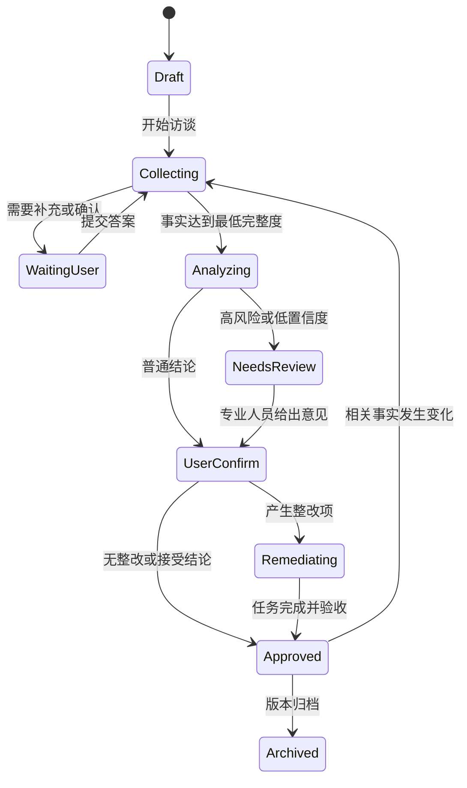
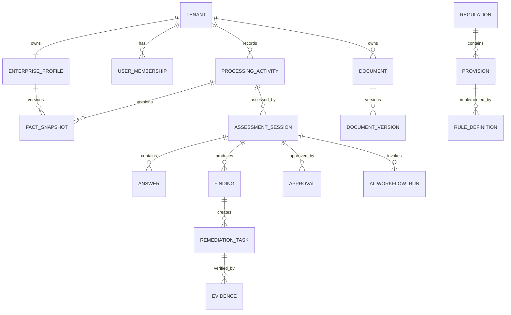
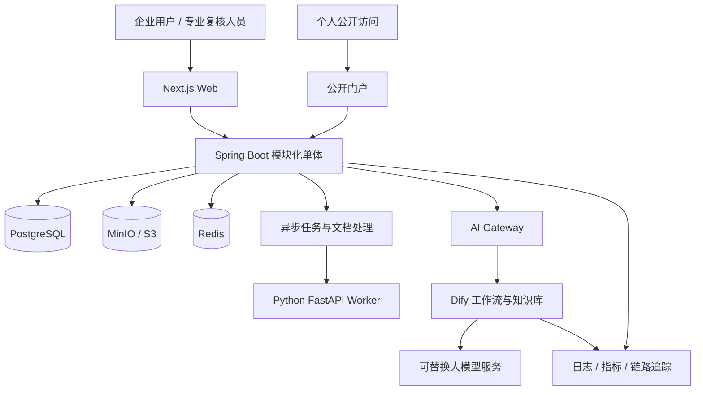

# 小型个人信息处理者合规平台总体规划（V1.0）

> 文档性质：产品蓝图、需求基线与技术设计指导  
> 适用阶段：MVP 立项、原型设计、技术预研、一期开发  
> 编制日期：2026-08-08  
> 核心边界：仅面向中国境内的小型个人信息处理者，以其日常、刚需、可标准化的数据合规工作为服务对象

## 1. 文档结论

本产品应定位为：**小型个人信息处理者的一站式个人信息保护合规工作台**。

它不是一个法规问答机器人，也不是只生成隐私政策的工具，更不是面向大型集团的隐私治理平台。平台要把法规要求转化为小企业能够理解、能够完成、能够留证的具体工作，并持续保存企业事实、判断过程、文档版本、整改记录和证据。

产品的最小闭环是：


平台的核心价值不是“给出一个答案”，而是让一家资源有限的小企业能够：

- 知道自己要做什么；
- 用尽量少的问题补齐关键事实；
- 得到与自身业务一致的政策文本、评估表和操作清单；
- 把整改落实到责任人、日期和证据；
- 在业务或法规变化后知道哪些内容需要重做；
- 面对检查、投诉或内部交接时，可以快速导出完整记录。

## 2. 产品定位与边界

### 2.1 目标客户

首期聚焦同时符合以下特征的组织：

- 在中国境内开展业务；
- 当前处理的自然人个人信息少于 10 万人，已删除的个人信息不计入；
- 没有专职或只有兼职法务、合规、信息安全人员；
- 业务场景相对标准，例如官网、公众号、小程序、门店会员、预约报名、售后服务、员工管理、简单电商或 SaaS 服务；
- 包括少量处理员工、招聘候选人、客户/供应商联系人信息的在华外资 B2B 企业；“外资”不自动等同于数据出境，“B2B”也不自动等同于不处理个人信息；
- 希望以较低成本完成基础个人信息保护工作，并形成可检查、可追溯的记录。

### 2.2 主要购买者与使用者

| 角色 | 典型人员 | 主要诉求 |
|---|---|---|
| 企业负责人 | 创始人、总经理、门店负责人 | 快速知道风险、成本和需要批准的事项 |
| 合规负责人 | 行政、法务、人事或运营兼任 | 按步骤完成任务，维护文档和记录 |
| 业务负责人 | 产品、运营、市场、人事、客服 | 描述业务事实，确认具体处理活动 |
| 技术负责人 | 开发、运维、外包技术商 | 落实权限、日志、删除、安全等整改措施 |
| 外部服务人员 | 律师、合规顾问、安全服务商 | 复核高风险事项，提出意见并确认结论 |
| 普通个人 | 客户、员工、访客 | 查看规则、提交权利请求或联系企业 |

### 2.3 明确不做什么

一期及可预见的二期不建设以下能力：

- 面向跨国集团的全球多法域隐私治理；
- 复杂的数据地图自动发现、终端扫描或数据库全量识别；
- 大型企业级 GRC、复杂 BPM、供应链全生命周期管理；
- 复杂数据出境合规的自动定案；
- 自动代替律师给出无保留法律意见；
- 用一个通用聊天框承载全部工作；
- 让大模型自行决定全部合规结论；
- 为了展示技术而引入多智能体、微服务集群或重量级规则引擎。

系统发现以下情形时，应进入“专业复核/升级服务”而不是强行自动完成：接近或超过 10 万人、处理活动特别复杂、存在大量敏感个人信息、未成年人信息、高风险生物识别、医疗健康或金融账户信息、复杂数据出境、重大安全事件、监管调查或群体投诉等。

### 2.4 产品一句话差异化

通用 AI 帮用户完成一次任务；本平台负责维护一家小企业的**持续合规状态**。

与 Codex、WorkBuddy 等通用工具相比，差异不应建立在“模型更聪明”上，而应建立在以下产品资产上：

- 经过设计的小型处理者适用规则和确定性判断；
- 可复用、可确认、带时效性的企业事实库；
- 结构化的业务场景和合规工作流；
- 法规、企业事实、政策文本、评估结论之间的引用关系；
- 审批、整改、证据、复评构成的闭环；
- 法律规则和模板的版本治理；
- 高风险事项的人工复核门槛；
- 面向检查和交接的一键导出能力。

如果产品最终只是“上传法规 + 聊天 + 生成报告”，则上述差异化不成立。

## 3. 法规基础与产品化解释

本规划主要依据《小型个人信息处理者个人信息保护简化措施规定》及《中华人民共和国个人信息保护法》等现行规则。《规定》由国家互联网信息办公室、公安部以第 25 号令公布，自 2026 年 9 月 1 日起施行。当前产品基线采用以下要求：

- 小型个人信息处理者的判断以当前处理的自然人人数少于 10 万人为核心，已删除信息不计入；
- 对外规则应包括处理者名称、个人行使权利的联系方式、处理目的、方式、种类和保存期限等必要内容；
- 处理不满 14 周岁未成年人个人信息应制定专门规则；
- 敏感个人信息仍需满足单独同意等法定要求；
- 仅依托网络平台开展业务且满足规定条件时，可以适用平台统一规则以及避免重复审计、评估等简化安排，系统应逐项核验而不是默认豁免；
- 合并、分立、解散、破产等原因转移个人信息时，存在提前公开和持续公开的时间要求；
- 向境外提供个人信息存在特定豁免情形，但告知、单独同意等义务并不当然免除；
- 应建立便捷的个人权利请求机制；
- 停止相关业务时应按要求删除个人信息；
- 个人信息保护合规审计原则上至少每五年一次，相关表单留存至少五年；
- 个人信息保护影响评估相关表单留存至少三年；
- 内部管理制度和事件应急要求可以纳入现有组织管理文件；
- 发生个人信息安全事件后应立即采取补救措施，并依法履行通知等义务。

这些规则在系统中不能只作为知识库文章存在，而要被拆成：

1. **确定性规则**：期限、必填字段、触发条件、保存年限、状态门槛；
2. **事实问题**：企业性质、人数、信息种类、对象、目的、共享情况、保存期限等；
3. **专业判断**：必要性、影响程度、风险是否可接受、措施是否充分；
4. **工作成果**：政策文本、评估表、审计表、整改任务、证据和复核记录。

法规来源与更新必须优先采用国家网信部门、全国人大及其他有权机关的正式文本。法规与模板发布前必须由专业人员复核，模型生成内容不能直接成为平台的“确定规则”。

## 4. 产品设计原则

### 4.1 任务优先，而非聊天优先

首页首先告诉用户“当前需要做什么”，例如：完善企业档案、确认一个高风险答案、更新隐私规则、上传整改证据。AI 对话是完成任务的交互方式之一，不是产品的信息架构。

### 4.2 一次采集，持续复用

企业名称、业务性质、用户规模、联系方式等稳定事实只询问一次。场景变化时只追问差异。任何旧事实被复用时，界面必须展示来源、更新时间和“仍然准确”的确认入口。

### 4.3 少问，但不能漏问

问题应分三层：

- 硬门槛问题：决定适用范围或法律触发条件，必须回答；
- 风险分支问题：仅在前一答案触发时出现；
- 文本补充问题：可以从已有文档提取并让用户确认，避免重复填写。

### 4.4 规则、AI、人工各司其职

- 规则负责明确条件和硬性约束；
- AI 负责理解自然语言、提取事实、发现矛盾、生成追问、检索依据和起草文本；
- 人工负责确认企业事实、审批对外文本、接受风险和复核复杂事项。

### 4.5 结论必须能解释

每个重要结论都应展示：引用的企业事实、适用规则、判断理由、缺失信息、风险级别和建议动作。不得只输出一个不可追溯的“合规/不合规”分数。

### 4.6 默认形成证据

每次确认、审批、更新、评估和整改都应自动留下时间、人员、版本和附件。合规不是一次报告，而是一组能够被证明的活动。

### 4.7 产品语言小企业化

界面使用“你在什么场景收集这些信息”“请安排负责人删除”等表达。专业术语可以出现在解释和正式文档中，但不能成为完成任务的前提。

## 5. 产品总体信息架构

### 5.1 企业端一级导航

建议控制在七个入口：

1. **工作台**：待办、风险提示、即将到期、最近变更；
2. **企业档案**：组织信息、规模判断、联系人、系统与服务商；
3. **业务场景**：各类个人信息处理活动及其评估状态；
4. **政策与文档**：隐私规则、未成年人规则、内部制度、版本与发布；
5. **合规任务**：整改、审批、复核和证据；
6. **个人请求与事件**：权利请求、安全事件及处理记录；
7. **合规档案**：评估、审计、操作日志、归档与导出。

“法规知识”可以作为帮助中心或右侧解释入口，不必占据企业用户的主导航。

### 5.2 运营管理端

平台运营管理端至少包括：

- 法规与条款版本管理；
- 规则包和模板包管理；
- 行业/场景模板管理；
- AI 工作流版本与灰度发布；
- 专业复核队列；
- 企业升级/超范围告警；
- 模型质量评测和错误案例管理；
- 租户、套餐、容量和服务状态管理；
- 安全审计和操作日志查询。

### 5.3 对外公开页

“小微个保合规码”属于对外层能力，建议作为企业公开门户的一部分：

- 展示当前有效的个人信息处理规则；
- 展示企业名称和权利请求联系方式；
- 提供权利请求提交入口；
- 展示文档版本、生效日期和更新时间；
- 可生成链接和二维码供官网、公众号、小程序或门店使用。

二维码只证明“可访问当前公开内容”，不能简单宣称企业已经全面合规，更不能作为平台替企业背书的认证标志。

## 6. 端到端核心用户旅程

### 6.1 首次建立企业档案

采用 Claude for Legal 冷启动访谈的思路，但压缩到小企业可接受的程度：

- 快速模式：约 8—12 个必答问题，先建立最小档案；
- 完整模式：约 20—30 个问题，覆盖部门、渠道、系统、服务商和既有文档；
- 支持上传现有隐私政策、员工手册、产品说明，由 AI 提取候选事实；
- 所有提取事实必须经用户逐项或批量确认后才能成为正式事实；
- 完成后生成“企业情况摘要”，由负责人确认并锁定为档案版本。

核心问题包括：

- 企业主体、行业、主要业务和经营渠道；
- 大致处理人数及统计口径；
- 信息主体类别，例如客户、潜在客户、员工、访客；
- 是否处理未成年人或敏感个人信息；
- 是否向其他公司提供、委托处理、公开或跨境传输；
- 主要系统、应用、表格和第三方服务商；
- 当前规则、同意页面、内部制度和联系人情况。

### 6.2 小型处理者资格判断

系统必须单独提供适用范围判断，不把它埋在问卷中。输出分为：

- **当前适用**：现有事实满足小型处理者范围；
- **临界关注**：人数接近阈值或统计口径不可靠，设置复核提醒；
- **无法判断**：关键信息缺失，生成补充任务；
- **不适用/需升级**：达到阈值或存在需专业服务的复杂情况。

判断结果要记录使用的数据口径、时间点、负责人和证据，例如后台用户量截图或会员数量报表。

### 6.3 新业务场景评估

用户不从“做 PIPIA”开始，而从自然业务语言开始，例如：

- 我要上线会员注册；
- 门店要做人脸门禁；
- 要用第三方短信服务；
- 人事要收集应聘者简历；
- 小程序准备增加定位功能。

流程如下：

1. AI 将自然语言归类为一个或多个处理活动；
2. 复用企业档案，展示已知事实；
3. 规则引擎进行快速分流；
4. 对缺失的高信息量事实进行动态追问；
5. 输出普通检查、简化评估、完整影响评估或专业复核路径；
6. 生成结论、文本改动和整改任务；
7. 由业务与合规负责人确认；
8. 完成后沉淀为新的处理活动版本。

### 6.4 隐私规则生成与一致性检查

系统读取已经确认的企业事实和处理活动，不让用户重复填写。工作流应：

- 检查法定项目是否齐全；
- 检查政策文本与真实业务是否一致；
- 检查页面提示、同意文案和政策正文是否相互一致；
- 对敏感个人信息、未成年人、第三方共享等生成专门条款或提示；
- 标出无法从事实库确认的表述；
- 生成带引用的修订建议和对照稿；
- 经审批后发布为新版本，并同步公开页。

### 6.5 自查、评估和整改

系统应内置三类不同深度的工作：

| 类型 | 适用情形 | 主要产物 |
|---|---|---|
| 场景快速检查 | 普通新增或变更 | 风险提示、必要改动、任务清单 |
| 个人信息保护影响评估 | 法律触发或较高风险场景 | 结构化评估表、结论、审批、三年以上留存 |
| 合规审计自查 | 周期性或专项检查 | 审计表、问题清单、整改证据、五年以上留存 |

任何发现都必须能够一键转为整改任务，包含责任人、截止日期、验收标准和证据要求。

### 6.6 个人权利请求

公开页或后台录入请求后：

- 记录请求人、请求类型、对象、渠道和时间；
- 引导工作人员核验身份，但避免过度收集；
- 生成内部检索清单和答复草稿；
- 记录延期、拒绝或无法处理的理由；
- 由负责人审批后发送或线下反馈；
- 保存处理过程和证明材料。

一期可以只做案件台账、模板和时限提醒，不必自动连接企业所有业务系统。

### 6.7 安全事件

采用“应急清单 + 记录 + 升级”模式：

- 事件首次报告；
- 影响范围和信息类型；
- 已采取的隔离、修复、删除、密码重置等措施；
- 是否需要通知个人或主管机关的辅助判断；
- 决策人、处理时间线和附件；
- 事后复盘和整改任务。

安全事件不应完全由 AI 自动定性。中高风险事件默认进入人工专业复核。

### 6.8 变更驱动的持续合规

以下变更应触发局部复评：

- 新增信息类型、处理目的或对象；
- 新增第三方服务商或共享对象；
- 保存期限、收集渠道或功能发生变化；
- 开始处理敏感信息或未成年人信息；
- 用户规模接近阈值；
- 法规、规则包或模板发生重要更新；
- 隐私政策与企业事实出现漂移。

系统只重跑受影响的规则和文档，不要求用户从头再做一遍。

## 7. 功能范围与优先级

### 7.1 P0：MVP 必须形成的闭环

| 模块 | P0 功能 |
|---|---|
| 账户与企业 | 注册登录、租户隔离、企业信息、成员和简单角色 |
| 企业档案 | 引导访谈、事实确认、人数与范围判断、版本快照 |
| 业务场景 | 新建场景、模板选择、动态问答、活动清单、版本管理 |
| 法规与规则 | 法规版本、条款结构、确定性规则包、引用关系 |
| 文档中心 | 上传、文本提取、模板生成、版本对比、审批、发布 |
| AI 评估 | 场景分流、缺失事实追问、检索引用、结构化输出 |
| 合规任务 | 问题转任务、负责人、截止日、状态、附件和验收 |
| 评估档案 | 快速检查、官方 PIPIA/审计自查表数字化、签名确认、导出与留存 |
| 公共门户 | 有效隐私规则展示、联系入口、二维码 |
| 审计留痕 | 用户操作、AI 调用、审批、发布和导出的完整日志 |

### 7.2 P1：完成日常运营闭环

- 个人权利请求案件管理；
- 安全事件台账和应急清单；
- 周期性合规审计提醒；
- 法规变更影响分析；
- 政策与实际处理活动漂移检测；
- 外部专业人员协作与复核；
- 邮件、短信或企业微信待办提醒；
- 套餐、用量和运营后台。

### 7.3 P2：在客户验证后选择性建设

- 主流建站、小程序、CRM、HR SaaS 的轻量连接器；
- 页面/SDK 隐私声明配置检查；
- 供应商问卷和简化供应商台账；
- 行业模板市场；
- 服务机构白标和多客户工作台；
- 基于脱敏统计的行业基准。

## 8. 问答与评估方法

### 8.1 事实分层

| 层级 | 示例 | 生命周期 |
|---|---|---|
| 企业稳定事实 | 主体、行业、联系人 | 长期，定期确认 |
| 企业运营事实 | 用户规模、系统、供应商 | 数月，可触发复核 |
| 场景事实 | 目的、字段、对象、保存期限 | 随场景版本变化 |
| 评估时事实 | 具体技术措施、替代方案 | 属于一次评估快照 |
| 推断事实 | AI 从文档提取的候选内容 | 未确认前不得作为确定依据 |

每条事实至少保存：事实键、结构化值、自然语言说明、来源、提供者、确认者、确认时间、有效状态、敏感等级和适用范围。

### 8.2 动态追问策略

每次提问前依次判断：

1. 该事实是否已经存在且仍在有效期；
2. 能否从已上传文档中提取候选答案；
3. 该问题是否会改变适用范围、流程路径或风险等级；
4. 问题是否可以用普通业务语言表达；
5. 是否应提供“不确定/稍后确认”选项并生成任务。

AI 可以建议下一问题，但后端必须控制允许询问的字段、选项类型、跳转范围和最大问题数，避免自由对话失控。

### 8.3 评估状态机



### 8.4 风险等级与升级条件

建议使用四级而不是模糊百分制：

- L0 信息不足：不能判断，先补事实；
- L1 常规：标准模板和普通任务可以处理；
- L2 关注：需要负责人明确确认，可能需要额外措施；
- L3 专业复核：必须由律师、合规或安全专业人员复核。

后端硬规则至少覆盖：人数阈值、敏感信息、未成年人、自动化决策、公开、委托/共享、仅依托网络平台的简化条件、主体变更告知期限、跨境、高风险生物识别、安全事件和关键事实冲突。

## 9. AI 与 Dify 的产品边界

### 9.1 Dify 的定位

Dify 作为内部 AI 编排与知识检索层，用于把以下五类上下文组合起来：

1. 法规与专业解释；
2. 企业已确认事实；
3. 企业现有政策与其他文本；
4. 当前业务需求和场景；
5. 当前任务的规则、模板和输出格式。

Dify 不作为用户看到的主产品，不保存平台唯一真相，也不负责租户、审批、任务、证据和长期审计。

### 9.2 推荐工作流目录

一期不要建设一个万能工作流，建议拆成：

| 工作流标识 | 作用 | 一期 |
|---|---|---|
| `enterprise_profile_interview` | 提取企业事实、发现缺失项、生成下一批问题 | 是 |
| `small_processor_qualification` | 辅助解释适用范围和证据缺口 | 是，结论由后端规则控制 |
| `scenario_triage` | 将业务需求归类并选择评估深度 | 是 |
| `privacy_notice_generate_review` | 起草、审查和对照隐私规则 | 是 |
| `pipia_assessment` | 依照官方 5 类影响评估情形和固定判断维度生成分析与措施建议 | 是 |
| `audit_self_check` | 将问题树答案映射到官方 24 个审计事项并形成自查发现 | 是 |
| `regulation_gap_analysis` | 法规变更影响企业事实、文档和规则 | P1 |
| `policy_practice_drift` | 检查政策与实际处理活动漂移 | P1 |
| `rights_request_assist` | 分类请求并生成处理清单与草稿 | P1 |
| `incident_response_assist` | 辅助事件初判、处置清单和记录 | P1 |

### 9.3 平台与 Dify 的职责划分

| 能力 | 主平台 | Dify |
|---|---|---|
| 用户、租户、权限 | 负责 | 不负责 |
| 企业正式事实 | 负责并版本化 | 只接收当前快照 |
| 法规正式版本和硬规则 | 负责 | 用于检索与解释 |
| 问卷状态、暂停和恢复 | 负责 | 返回候选问题 |
| 确定性判断 | 负责 | 不得覆盖 |
| 语义理解、摘要、草拟 | 调用并校验 | 负责 |
| 任务、审批和证据 | 负责 | 只返回建议 |
| 模型调用日志 | 保存业务侧摘要 | 保存编排日志 |

### 9.4 Dify 工作流输入输出契约

平台调用统一 AI 网关，不允许业务模块直接耦合 Dify API。建议请求结构：

```json
{
  "workflow_code": "scenario_triage",
  "workflow_version": "1.2.0",
  "tenant_id": "t_xxx",
  "session_id": "as_xxx",
  "locale": "zh-CN",
  "regulation_bundle_version": "cn-small-pi-2026.1",
  "rule_results": [],
  "enterprise_fact_snapshot": {},
  "scenario_fact_snapshot": {},
  "document_refs": [],
  "user_request": "门店准备新增人脸门禁",
  "output_schema_version": "1.0"
}
```

统一响应应为结构化 JSON：

```json
{
  "run_id": "air_xxx",
  "status": "needs_input",
  "summary": "该场景涉及人脸信息，需要进一步确认必要性与替代方案。",
  "questions": [
    {
      "fact_key": "scenario.biometric.alternative_available",
      "question": "员工是否可以选择门卡、密码等不使用人脸的方式？",
      "answer_type": "single_choice",
      "options": ["可以", "不可以", "尚未确定"],
      "reason": "该答案会影响必要性和风险判断"
    }
  ],
  "findings": [],
  "citations": [],
  "confidence": "medium",
  "review_required": true,
  "warnings": []
}
```

后端必须对 JSON Schema、引用来源、枚举值和敏感输出进行验证。解析失败、缺乏引用或模型超时时进入可重试状态，不能生成“已通过”结论。

### 9.5 不能交给模型的事项

- 租户隔离和访问控制；
- 人数阈值、期限和法定保存年限；
- 最终是否适用小型处理者规定；
- 任务是否已经完成；
- 用户是否完成审批或单独同意；
- 文档正式版本和发布时间；
- 是否删除证据或审计记录；
- 高风险事项的最终法律结论。

## 10. 法规、知识与模板治理

### 10.1 内容分层

- **法规层**：法律、行政法规、部门规章、正式解释；
- **规则层**：由专业人员将条款转化为触发条件和要求；
- **指南层**：通俗解释、操作建议和常见问题；
- **模板层**：政策、同意文案、评估表、审计表、回复模板；
- **企业层**：企业上传的制度、声明、业务说明和证据。

平台检索时必须保留来源层级，优先引用正式法规。企业自有文本不能被误当作法律依据。

### 10.2 条款数据建议

每个条款记录至少包含：法规 ID、条款号、正文、发布机关、发布日期、效力层级、主题标签、适用对象、官方来源 URL、来源版本、替代关系、核验状态和内容哈希。首期不依据施行日期动态切换规则。

### 10.3 规则包版本

确定性规则建议采用可读的 YAML/JSON 定义并进入代码审查，例如：

```yaml
rule_id: SMALL_PROCESSOR_COUNT_THRESHOLD
version: 1.0.0
approval_status: published
when:
  fact: enterprise.current_distinct_person_count
  operator: gte
  value: 100000
result:
  qualification: not_applicable
  risk_level: L3
  message: 当前人数达到小型个人信息处理者适用范围上限
  action: professional_review
legal_basis:
  - regulation: small_processor_simplified_measures
    article: definition
```

规则发布需要制作者与复核者双人确认，记录批准时间、变更原因和回滚版本；发布后的评估统一使用当前获准规则包，不按法规施行日期切换。

### 10.4 知识入库与检索

建议流程：抓取/上传正式文本 → 文本解析 → 按条款切分 → 人工校验 → 元数据标注 → 发布法规版本 → 同步 Dify 知识库 → 建立抽样检索测试。

一期可用 Dify 知识库完成混合检索。数据量、权限复杂度或召回评测达到瓶颈后，再考虑 OpenSearch/Elasticsearch 与向量库组合。不要在 MVP 之前自建复杂 RAG 平台。

### 10.5 官方审计自查表与影响评估表的产品化

《规定》的两个附件不是普通模板素材，而是系统首期表单、问题树和导出的**官方结构基线**。平台可以增加通俗解释、动态追问和证据管理，但不能擅自遗漏、合并或改写官方项目后仍声称是官方表单。

#### 10.5.1 合规审计自查表

官方自查表包含 24 个主事项，系统应逐项建立稳定的 `official_item_code`：

| 编号 | 官方审计主题 | 平台主要映射模块 |
|---:|---|---|
| 1 | 个人信息处理活动的合法性基础 | 企业事实、处理活动、同意记录 |
| 2 | 个人信息处理规则 | 政策与文档 |
| 3 | 告知义务 | 场景评估、页面/线下告知材料 |
| 4 | 共同处理 | 处理活动、合作方和约定 |
| 5 | 委托处理 | 服务商、合同和监督记录 |
| 6 | 合并、重组、分立、解散、破产等转移 | 主体变更专项流程 |
| 7 | 向其他处理者提供个人信息 | 共享活动、单独同意和影响评估 |
| 8 | 自动化决策 | 算法场景、告知、拒绝入口和评估 |
| 9 | 公开个人信息 | 公开场景、单独同意和影响评估 |
| 10 | 公共场所图像采集、身份识别设备 | 设备场景、必要性、标识和授权 |
| 11 | 已公开个人信息的处理 | 来源、目的、拒绝和合理范围 |
| 12 | 敏感个人信息 | 敏感类别、必要性、告知和同意 |
| 13 | 不满十四周岁未成年人信息 | 专门规则、监护人同意和必要性 |
| 14 | 向境外提供个人信息 | 跨境路径、数量口径和程序条件 |
| 15 | 删除权保障 | 删除触发条件、系统执行和例外 |
| 16 | 个人权利保障机制 | 权利请求入口和案件台账 |
| 17 | 响应个人请求与规则解释 | 时限、答复、拒绝理由和解释记录 |
| 18 | 内部管理制度和操作规程 | 组织、分类、权限、投诉和责任制度 |
| 19 | 技术措施有效性 | 保密性、完整性、可用性、去标识和权限 |
| 20 | 教育培训 | 计划、实施、考核和覆盖人员 |
| 21 | 个人信息保护负责人履职 | 人选、职责、权限、建议和联系方式 |
| 22 | 个人信息保护影响评估 | 评估触发、内容和结论 |
| 23 | 安全事件应急预案 | 风险预测、资源、流程、培训和演练 |
| 24 | 安全事件响应处置 | 报告、影响分析、通知、补救和复盘 |

每个主事项的官方结论枚举固定为：`合规 / 不合规 / 不适用`。系统内部可以另设“未回答、待补证、待复核”等工作状态，但不能把工作状态混入官方结论。

数字化要求如下：

- 一个官方主事项可以拆成多个通俗子问题，但每个子问题必须反向映射到主事项及其官方审查要点；
- 选择“不适用”必须填写适用性理由，并允许专业人员复核；
- 选择“不合规”时自动生成一个或多个发现和整改任务；
- 选择“合规”时仍可要求上传证明材料或关联既有证据；
- 每项支持填写“不合规及整改情况说明”、关联任务和附件；
- 表尾保留其他说明、证明材料、审计负责人确认和日期；
- 审计完成后冻结事实快照、表单版本、规则包版本和证据清单；
- 官方审计自查表至少保存五年，系统默认不得在期限内删除相关实例和附件。

#### 10.5.2 个人信息保护影响评估表

官方影响评估表不是一份开放式报告，而是 5 类影响评估情形 × 3 个固定判断维度的矩阵。

五类情形为：

1. 处理敏感个人信息；
2. 利用个人信息进行自动化决策；
3. 委托处理、向其他个人信息处理者提供个人信息或公开个人信息；
4. 向境外提供个人信息；
5. 其他对个人权益有重大影响的个人信息处理活动。

每类情形均评估：

- 处理目的、处理方式等是否合法、正当、必要：`是 / 否 / 不适用`；
- 对个人权益的影响及安全风险：`有影响 / 不适用`。官方附件未设置“无影响”选项，平台内部可以记录影响程度，但不得改变官方导出枚举；
- 保护措施是否合法、有效并与风险程度相适应：`是 / 否 / 不适用`。

平台不能仅保存三个复选结果。每个结论还应关联事实、风险说明、保护措施、法规依据、责任人和证据。表尾应保留影响评估负责人确认和日期，正式实例至少保存三年。

#### 10.5.3 两层表单设计

为了兼顾官方格式与实际可操作性，采用两层结构：

- **工作底稿层**：动态问题、AI 解释、证据、发现、整改任务、复核意见；
- **官方结果层**：严格按附件的行、选项、备注、负责人和日期生成归档表。

用户日常操作的是工作底稿，归档和导出时生成官方结果表。任何官方项目都必须能从结果表下钻到对应问题、事实和证据；任何内部扩展项都不能伪装成官方要求。

#### 10.5.4 表单版本治理

- 官方附件原文以只读模板版本保存，记录来源、发布日期、模板版本、替代关系和文件哈希；
- 专业人员可以发布“问题解释包”和“证据建议包”，但不直接修改官方原文；
- 法规附件更新时，新建模板版本并进行字段差异比较；
- 已签署实例继续绑定原模板，不能被新版本覆盖；
- 新版本启用后，系统计算未完成实例和历史结论是否需要复评。

## 11. 领域模型与核心数据

### 11.1 核心关系



### 11.2 主要实体及关键字段

#### 租户与身份

- `tenant`：id、名称、状态、套餐、数据保留配置、创建时间；
- `user`：id、登录标识、姓名、状态、MFA 状态；
- `membership`：tenant_id、user_id、角色、数据范围；
- `role_permission`：角色、资源、动作、条件。

#### 企业与事实

- `enterprise_profile`：主体名称、统一社会信用代码、行业、规模状态、负责人、当前版本；
- `processing_activity`：名称、场景类型、业务负责人、状态、首次启用时间、当前版本；
- `fact_definition`：事实键、名称、数据类型、选项、敏感等级、有效期策略；
- `fact_value`：对象类型、对象 ID、事实键、值、来源、状态、置信度；
- `fact_snapshot`：快照 ID、对象、版本、生成原因、确认人、确认时间、内容哈希。

#### 文档与法规

- `document`：类型、名称、所属范围、状态、当前版本；
- `document_version`：原文件、解析文本、结构化内容、版本号、来源、审批状态、生效时间；
- `document_relation`：文档版本与事实、场景、评估、法规条款的关系；
- `regulation`、`provision`、`rule_definition`、`template`、`template_version`。

#### 评估与闭环

- `assessment_session`：评估类型、对象、状态、规则包版本、事实快照、发起人；
- `question`：事实键、问题、类型、选项、触发条件、是否必答；
- `answer`：答案、来源、回答人、确认状态；
- `finding`：问题类型、风险等级、事实引用、法规引用、理由、状态；
- `remediation_task`：标题、责任人、截止日、验收标准、状态；
- `evidence`：附件、说明、提交人、哈希、验收状态；
- `approval`：对象、审批人、结论、意见、时间。

#### 官方表单

- `form_template`：表单类型、官方名称、来源、状态；
- `form_template_version`：版本、替代关系、原始文件哈希、结构化 Schema、发布状态；
- `form_section`：章节、顺序和显示规则；
- `form_item`：官方项目编码、官方原文、选项定义、父子关系；
- `form_question_mapping`：官方项目与企业事实、动态问题、规则的映射；
- `form_instance`：租户、业务范围、模板版本、状态、事实快照、留存至；
- `form_response`：官方结论、说明、引用事实、证据和复核状态；
- `signature_snapshot`：确认人、角色、确认声明、时间、认证方式和内容哈希。

#### 服务事件

- `rights_request`：类型、接收渠道、身份核验状态、截止日期、处理结论；
- `security_incident`：发现时间、影响范围、风险级别、处置状态、通知决定；
- `public_portal`：公开标识、当前文档版本、联系入口、二维码状态。

#### AI 与审计

- `ai_workflow_definition`：工作流编码、Dify app 标识、输入输出 schema、启用版本；
- `ai_workflow_run`：请求摘要、响应摘要、模型、耗时、token、引用、校验结果、错误；
- `audit_log`：主体、动作、对象、前后版本、时间、IP/设备摘要、追踪 ID。

### 11.3 关键状态枚举

- 文档：`draft / under_review / approved / effective / superseded / archived`；
- 处理活动：`draft / active / changing / stopped / archived`；
- 评估：`draft / collecting / analyzing / needs_review / user_confirm / remediating / approved / archived`；
- 整改：`open / in_progress / submitted / accepted / rejected / waived / closed`；
- 事实：`candidate / confirmed / disputed / expired / superseded`；
- AI 运行：`queued / running / needs_input / succeeded / failed / invalid_output`。
- 官方表单实例：`draft / collecting / reviewing / remediation / ready_to_sign / signed / archived`。

数据库不得以覆盖方式更新关键事实、文档和评估结论，应保留不可变版本及其关联。

## 12. 技术架构与技术栈

### 12.1 总体架构



### 12.2 推荐技术选型

| 层次 | 推荐 | 理由 |
|---|---|---|
| Web 前端 | TypeScript、React、Next.js、Ant Design | 后台工作台成熟，表单与表格生态好 |
| 主后端 | Java LTS、Spring Boot、Spring Security | 适合结构化业务、权限、审计和长期维护 |
| 架构形态 | 模块化单体 | 小团队交付快，事务清晰，可按需拆分 |
| 主数据库 | PostgreSQL | 关系、JSONB、全文能力平衡，适合作为唯一事实源 |
| 对象存储 | MinIO（私有部署）或兼容 S3 服务 | 保存文档、证据、导出包 |
| 缓存/轻量队列 | Redis | 会话缓存、限流、短任务和分布式锁 |
| 文档处理 | Python、FastAPI、PyMuPDF/pdfplumber、python-docx、OCR | 文档生态成熟，与主后端解耦 |
| AI 编排 | 自托管 Dify | 快速管理知识库、提示词和工作流版本 |
| 可观测性 | OpenTelemetry、Prometheus、Grafana、集中日志 | 统一追踪一次评估跨平台和 Dify 的链路 |
| 部署 | 开发/试点 Docker Compose；规模化后再评估 Kubernetes | 控制初期复杂度和运维成本 |

### 12.3 后端模块

建议一个代码仓库内按领域模块划分：

- `identity`：登录、成员、角色；
- `tenant`：租户、套餐、配额；
- `enterprise`：企业档案和事实；
- `processing`：处理活动和场景模板；
- `regulation`：法规、条款和规则包；
- `document`：文件、版本、解析、发布；
- `assessment`：问答、评估、发现；
- `remediation`：任务、证据和验收；
- `approval`：审批流程；
- `rights`：权利请求；
- `incident`：安全事件；
- `publicportal`：公开页和二维码；
- `ai_gateway`：Dify 适配、schema 校验、重试、用量；
- `audit`：不可抵赖操作记录与导出。

模块之间通过明确应用服务和领域事件通信，不允许跨模块随意直接读写表。

### 12.4 暂不采用的技术

- 微服务：一期业务和团队规模不足以抵消分布式复杂度；
- Kubernetes：试点期使用成本高于收益；
- Drools 等重量规则引擎：版本化 YAML/JSON 与简单解释器足够；
- 多智能体：增加结果不确定性和调试成本；
- 自建通用向量平台：先验证内容和工作流价值；
- 复杂流程引擎：核心状态机在业务代码中实现即可。

## 13. API 与集成设计

### 13.1 API 设计原则

- 对外 API 使用 REST/JSON，统一 `/api/v1`；
- 所有租户资源从认证上下文确定租户，不信任前端传入租户 ID；
- 更新关键对象需要版本号或 ETag，避免覆盖他人修改；
- 写操作支持幂等键；
- 所有请求带 `trace_id`；
- AI 长任务采用异步运行和状态查询，必要时支持 SSE 展示进度；
- 导出、解析、OCR 等任务统一进入作业中心。

### 13.2 首期关键端点示例

```text
POST   /api/v1/enterprises/profile-sessions
GET    /api/v1/enterprises/current-profile
POST   /api/v1/enterprises/facts:confirm
POST   /api/v1/qualifications:assess

POST   /api/v1/processing-activities
POST   /api/v1/processing-activities/{id}/triage-sessions
POST   /api/v1/assessment-sessions/{id}/answers
POST   /api/v1/assessment-sessions/{id}:analyze
POST   /api/v1/assessment-sessions/{id}:confirm

POST   /api/v1/documents
POST   /api/v1/documents/{id}/versions
POST   /api/v1/document-versions/{id}:review
POST   /api/v1/document-versions/{id}:approve
POST   /api/v1/document-versions/{id}:publish

GET    /api/v1/remediation-tasks
POST   /api/v1/remediation-tasks/{id}/evidence
POST   /api/v1/remediation-tasks/{id}:accept

GET    /public/v1/{publicCode}/privacy-notice
POST   /public/v1/{publicCode}/rights-requests
```

### 13.3 异步事件

首期可以采用数据库 Outbox + 后台任务，不必立即部署 Kafka。关键事件包括：

- `EnterpriseFactConfirmed`；
- `ProcessingActivityChanged`；
- `AssessmentApproved`；
- `FindingCreated`；
- `DocumentPublished`；
- `RegulationBundleActivated`；
- `QualificationThresholdApproaching`。

事件处理要幂等，并保存事件 ID、处理状态和重试次数。

## 14. 安全、隐私与多租户设计

平台自身处理大量企业合规资料，必须从第一版实现以下控制：

- 数据库所有业务表均带租户标识，并在持久化层强制过滤；
- 企业管理员、普通成员、只读人员、外部复核者采用最小权限；
- 外部复核人员按事项、期限授权，不能默认查看整个企业；
- 传输使用 TLS，数据库和对象存储使用静态加密；
- 敏感字段使用应用层或列级加密，密钥与数据分离；
- 文件上传执行类型、大小、恶意内容检查；
- Dify 与模型调用前执行最小化和脱敏策略；
- 默认不使用企业数据训练公共模型；
- 提示词、检索内容、模型输出防止被文档中的恶意指令操控；
- 重要操作支持 MFA、二次确认和审计；
- 备份、恢复演练、对象存储版本和日志保留有明确策略；
- 租户注销采用可配置的冷静期、导出和安全删除流程；
- 开发、测试、生产环境严格分离，测试数据不得复制真实企业资料。

AI 调用日志不应无差别永久保存完整原文，应分别配置业务记录、技术调试记录和敏感内容的保留期限。

## 15. AI 质量与测试体系

### 15.1 从第一天建立评测集

每个工作流至少建立：

- 20 个正常样例；
- 10 个边界/缺失事实样例；
- 10 个高风险升级样例；
- 5 个文档内容冲突样例；
- 5 个提示注入或恶意文件样例。

样例由产品、法律和技术共同确认，输入、期望规则结果、允许的表述范围和禁止输出均需版本化。

### 15.2 关键指标

| 指标 | MVP 发布门槛建议 |
|---|---|
| 硬规则正确率 | 100% 自动化测试通过 |
| 高风险漏报率 | 0 个已知金标案例漏报 |
| 错误“通过”率 | 低于 1%，且不得涉及硬门槛 |
| 法规引用有效率 | 95% 以上引用可定位到有效条款 |
| 结构化输出可解析率 | 99% 以上 |
| 重复提问率 | 已确认有效事实不重复询问，目标 95% 以上 |
| 文档关键项目完整率 | 金标模板 100% 覆盖 |
| 普通评估完成时间 | 中位数不超过 20 分钟 |

最重要的指标不是语言流畅度，而是**错误放行率**。系统宁可标记“信息不足”或“需复核”，也不能虚构事实后判定合规。

### 15.3 测试层次

- 单元测试：规则表达式、状态机、权限、期限计算；
- 契约测试：主平台与 Dify 的输入输出 Schema；
- 集成测试：上传文档、提取、评估、审批、发布全链路；
- RAG 评测：召回率、错误法规版本、引用准确性；
- 安全测试：越权、租户穿透、文件上传、提示注入、敏感日志；
- 恢复测试：Dify 超时、模型不可用、任务重试和人工接管；
- 用户测试：由 5—10 家真实小企业完成典型任务并观察卡点。

### 15.4 AI 发布机制

提示词、知识库、模型和工作流任何一项变化都生成新版本。新版本先跑离线金标集，再在内部租户灰度，指标满足门槛后逐步放量；必须可一键回滚到上一个稳定版本。

## 16. 可观测性、成本和可靠性

### 16.1 关键监控

- API 成功率与 P95 延迟；
- 文档解析/OCR 成功率；
- Dify 工作流耗时、失败率和结构化输出失败率；
- 模型 token、单评估成本和租户用量；
- 检索无结果率、引用失效率；
- 任务队列积压；
- 登录异常、越权拒绝和文件安全事件；
- 关键业务漏斗：档案完成率、评估完成率、整改闭环率。

### 16.2 成本控制

- 先执行硬规则，再调用模型；
- 只传当前工作流所需的最小事实快照；
- 长文档先解析、切分和检索，不把全部文档塞入上下文；
- 对法规和模板检索结果做短期缓存；
- 简单提取与分类使用较低成本模型，复杂评估使用更强模型；
- 套餐按活跃企业、评估次数、文档页数或专业复核服务组合，而不是只按 token 售卖。

### 16.3 可用性策略

即使 Dify 或模型短时不可用，用户仍应能查看档案、文档、任务和历史评估。AI 任务显示“稍后重试”，不能阻塞手工录入、审批和证据上传。

## 17. 交付路线图

建议以 12 周形成可试点 MVP，前提是核心团队约 5—7 人，并有稳定的法律专家参与。

### 第 0 阶段：开发基线（第 1—2 周）

目标：确定能够开工的共同语言和接口。

- 完成核心用户流程原型；
- 完成事实字典 V1、场景分类 V1；
- 将规定转化为规则清单和引用表；
- 将官方 24 项审计表和 5 类影响评估表转换为只读模板 Schema，并完成逐项校验；
- 定义数据库 ERD、OpenAPI 和 AI JSON Schema；
- 搭建单仓库、开发环境、持续集成和基础监控；
- 部署测试版 Dify，完成最小知识库；
- 建立首批 30—50 个 AI 金标案例。

退出标准：三方（产品、法律、技术）能用同一实例走通纸面/原型上的首个完整案例。

### 第 1 阶段：企业档案与资格判断（第 3—4 周）

- 账户、租户、成员和角色；
- 快速/完整企业访谈；
- 文档上传与事实候选提取；
- 事实确认、快照和变更记录；
- 小型处理者资格判断与临界提醒；
- 企业摘要页面。

退出标准：新企业在 15 分钟内建立最小档案，资格判断可解释且有证据口径。

### 第 2 阶段：场景评估闭环（第 5—7 周）

- 业务场景新建和场景模板；
- 动态问题、暂停恢复、事实复用；
- 硬规则执行、AI 场景分流和专业复核门槛；
- 发现、整改任务、责任人、证据与验收；
- 评估报告预览与导出。

首批场景只选择 5—8 个高频场景，例如招聘与员工管理、B2B 客户/供应商联系人管理、官网商务联系表单、营销联系、第三方云服务或全球 CRM/HR/邮箱、普通会员服务、访客登记和普通视频监控。外资企业若使用境外集团系统，先通过事实问题确认存储地、境外访问和接收方，再决定是否进入出境评估；不得仅凭外资身份触发。

退出标准：至少 10 个金标案例和 3 家试点企业走通从需求到整改完成的闭环。

### 第 3 阶段：政策文档与公开门户（第 8—9 周）

- 隐私规则生成与审查；
- 文档版本对比、审批、生效和归档；
- 未成年人专门规则分支；
- 公开页面、联系入口和二维码；
- 文档与事实漂移的基础检查。

退出标准：政策文本的每个关键条款能追溯到事实或法规，发布过程有完整审批记录。

### 第 4 阶段：自查评估与上线准备（第 10—12 周）

- 简化 PIPIA 和合规审计自查表；
- 留存期限与到期提醒；
- 合规档案打包导出；
- 安全、性能、备份恢复和租户隔离测试；
- AI 评测、灰度和回滚机制；
- 试点反馈修正与运营后台最低能力。

退出标准：满足第 18 节 MVP 验收要求，可供 10—30 家受控试点企业使用。

### 二期候选（MVP 后 8—12 周）

- 权利请求全流程；
- 安全事件处置台账；
- 法规变化影响分析；
- 周期性审计提醒；
- 外部专业复核协作；
- 更多行业场景模板；
- 套餐和服务运营能力。

## 18. MVP 验收标准

MVP 不是“页面开发完成”，而是同时满足以下业务、法律、技术和 AI 条件。

### 18.1 业务验收

- 一家全新小企业可以独立完成建档、资格判断和至少一个场景评估；
- 已确认事实可被后续工作流复用，用户能看懂事实来源；
- 每个发现都能形成任务并通过证据关闭；
- 可以生成、审批、发布和撤换一份对外隐私规则；
- 可以导出某一评估的事实、依据、结论、审批、任务和证据。

### 18.2 法律内容验收

- 小型处理者适用范围规则经专业复核；
- 首批场景的触发条件、问题、模板和升级门槛均有条款依据；
- 隐私规则法定字段和未成年人分支完整；
- PIPIA、审计表和留存策略与当前规则一致；
- 审计导出完整包含官方 24 个主事项、三种结论、说明、负责人和日期；
- 影响评估导出完整包含官方 5 类情形、三个固定判断维度、备注、负责人和日期；
- 官方项目原文、编号、选项和顺序通过模板一致性自动测试；
- 所有 AI 输出明确标识为辅助草稿，关键结论有人工确认点。

### 18.3 技术验收

- 自动化测试覆盖所有硬规则和关键状态流转；
- 不存在已知租户越权路径；
- 关键对象具备版本、审计和恢复能力；
- Dify 不可用时主平台基础功能仍可使用；
- 文档、数据库和对象存储已验证备份恢复；
- 一次评估的调用、规则、事实、模型、引用可通过 trace_id 追踪。

### 18.4 AI 验收

- 金标高风险案例无漏报；
- 不得用模型输出覆盖硬规则；
- 引用可定位且不混用失效法规；
- JSON 输出、异常重试和人工接管满足门槛；
- 关键事实缺失时输出“需补充/需复核”，不得自行臆造。

## 19. 团队与职责建议

| 角色 | 建议投入 | 主要职责 |
|---|---:|---|
| 产品负责人 | 1 | 产品边界、流程、试点客户和验收 |
| 法律/合规专家 | 1—2 | 条款转规则、问题与模板、案例复核 |
| 后端工程师 | 2 | 领域模型、权限、评估、任务、AI 网关 |
| 前端工程师 | 1—2 | 工作台、问答、文档、任务和公开页 |
| AI/文档工程师 | 1 | Dify、RAG、文档解析、评测体系 |
| 测试/安全 | 0.5—1 | 自动化、租户隔离、安全与发布门槛 |

法律专家不能只在上线前“看一下文案”，应作为规则、问题、模板和金标案例的共同所有者。

## 20. 主要风险与控制措施

| 风险 | 表现 | 控制措施 |
|---|---|---|
| 产品范围膨胀 | 客户不断提出大型 GRC 能力 | 用小型处理者和高频任务作为版本准入标准 |
| AI 虚构或误判 | 引用不存在、错误放行 | 硬规则优先、引用校验、金标评测、人工门槛 |
| 企业事实不真实 | 用户随意回答后生成“合规结论” | 来源、确认、证据、过期和冲突机制 |
| 规则更新失控 | 法规变化后旧结论继续使用 | 法规与规则版本、影响分析、触发复评 |
| 交互过重 | 小企业放弃长问卷 | 快速模式、按场景追问、文档提取、稍后补充 |
| 合规码被误解 | 被当作官方认证或全面背书 | 明确显示用途、版本和声明，不使用认证式措辞 |
| Dify 成为数据孤岛 | 事实和状态只存在工作流里 | 主平台为唯一事实源，Dify 只接收快照和返回建议 |
| 敏感资料泄露 | 文档或提示词进入不当模型 | 私有部署、最小化、脱敏、供应商配置和访问审计 |
| 过早技术复杂化 | 小团队被微服务/多智能体拖慢 | 模块化单体、简单事件、有限工作流、渐进拆分 |

## 21. 开发执行规范

后续开发应遵循以下共同约束：

1. 每个功能需求必须注明服务的小型处理者任务，不能只描述技术能力；
2. 每条确定性规则必须有规则 ID、法规依据、版本、审批状态和测试用例；
3. 每个 AI 工作流必须有输入输出 Schema、金标集、失败处理和人工接管点；
4. 每个关键结论必须能追溯到事实快照、规则版本和文档版本；
5. 每个对外文档必须经过明确审批才可生效；
6. 每个整改任务必须定义可验证的完成条件；
7. 数据库迁移、规则包、模板和 Dify 工作流均纳入版本管理；
8. 未经确认的 AI 提取结果只能标记为候选事实；
9. 新增模块前先验证是否可以用现有领域模型和状态机完成；
10. 任何“自动判定合规”的功能都需要产品、法律、技术三方评审。

## 22. 下一批开发前置产物

本总体规划通过后，应按以下顺序制作可执行设计：

1. [《官方附件数字化字段清单 V1》](C:/Software/PIPL/官方附件数字化字段清单-v1.0.md)（已完成）：逐项定义 24 个审计事项、5 类评估情形、固定选项、证据和签名字段；
2. [《事实字典与问题树 V1》](C:/Software/PIPL/事实字典与问题树-v1.0.md)（已完成）：定义事实键、问题、选项、有效期和触发关系，并映射官方附件项目；机器可读配置见 [fact-schema.v1.json](C:/Software/PIPL/schemas/fact-schema.v1.json) 和 [question-tree.v1.json](C:/Software/PIPL/schemas/question-tree.v1.json)；
3. [《首期场景目录与评估矩阵 V1》](C:/Software/PIPL/docs/首期场景目录与评估矩阵-v1.0.md)（已完成）：定义首期 8 个基础场景、横切风险分支、分流结论、问题和产物；机器可读配置见 [scenario-catalog.v1.json](C:/Software/PIPL/schemas/scenario-catalog.v1.json)；
4. [《法规条款—产品规则映射表 V1》](C:/Software/PIPL/docs/法规条款-产品规则映射表-v1.0.md)（已完成）：将法定义务和官方附件映射到 52 条确定性产品规则、事实、问题、任务和人工复核门槛；机器可读配置见 [ruleset.v1.json](C:/Software/PIPL/schemas/ruleset.v1.json)；
5. [《核心 ERD 与数据字典 V1》](C:/Software/PIPL/docs/核心ERD与数据字典-v1.0.md)（已完成）；
6. [《OpenAPI 与 AI JSON Schema V1》](C:/Software/PIPL/docs/OpenAPI与AI-JSON-Schema-v1.0.md)（已完成）：固定外部业务 API、公共接口、AI Gateway、Dify/模型输入输出、幂等、并发和错误协议；机器契约见 [openapi.v1.yaml](C:/Software/PIPL/api/openapi.v1.yaml) 与 [AI Schema 目录](C:/Software/PIPL/schemas/ai)；
7. [《关键页面原型与交互说明 V1》](C:/Software/PIPL/docs/关键页面原型与交互说明-v1.0.md)（已完成）；
8. [《Dify 工作流设计与提示词包 V1》](C:/Software/PIPL/docs/Dify工作流设计与提示词包-v1.0.md)（已完成）：定义六个首期工作流、62 个节点、Prompt、知识检索、模型路由、失败降级和发布门槛；机器清单及部署示例见 [Dify 设计包](C:/Software/PIPL/dify)；
9. 《AI 金标评测集与发布门槛 V1》；
10. 《MVP 迭代 Backlog》：拆成可估算的用户故事和验收条件；
11. 《试点客户操作脚本与反馈表》。

第一批开发不建议从“法规问答聊天页”开始，而应从**官方附件 Schema、企业档案、事实字典、资格判断和评估会话状态机**开始。这些内容构成后续政策生成、PIPIA、自查、权利请求和法规变更分析的共同基础。

## 23. 参考方法与来源

本规划借鉴 Claude for Legal `privacy-legal` 项目的方法：冷启动访谈、用例分流、独立专业工作流、来源分层、显式不确定性、人工审阅门槛，以及将分析结果转化为负责人/日期/状态明确的任务。借鉴的是产品与工作方法，不直接照搬境外法律概念、特权标记或其文件式存储方式。

- [Claude for Legal — Privacy Legal README](https://github.com/anthropics/claude-for-legal/blob/main/privacy-legal/README.md)
- [Cold Start Interview](https://github.com/anthropics/claude-for-legal/blob/main/privacy-legal/skills/cold-start-interview/SKILL.md)
- [Use Case Triage](https://github.com/anthropics/claude-for-legal/blob/main/privacy-legal/skills/use-case-triage/SKILL.md)
- [PIA Generation](https://github.com/anthropics/claude-for-legal/blob/main/privacy-legal/skills/pia-generation/SKILL.md)
- [Regulatory Gap Analysis](https://github.com/anthropics/claude-for-legal/blob/main/privacy-legal/skills/reg-gap-analysis/SKILL.md)
- [Policy Monitor](https://github.com/anthropics/claude-for-legal/blob/main/privacy-legal/skills/policy-monitor/SKILL.md)
- [《小型个人信息处理者个人信息保护简化措施规定》全文（政府网站转载，来源：中国网信网）](https://www.gzwxb.gov.cn/context/contextId/216547)
- [国家网信办《规定》答记者问](https://www.cac.gov.cn/2026-07/24/c_1786638889576451.htm)
- [中国网信网专家解读](https://www.cac.gov.cn/2026-07/24/c_1786639233707663.htm)
- [本次核对的官方附件 PDF](C:/Users/shihy/Desktop/小型个人信息处理者个人信息保护合规审计自查表+小型个人信息处理者个人信息保护影响评估表.pdf)（10 页，SHA-256：`B267919A2FFEBD634CB9587456A2D369B9F44CCAC3649CF7D63A0A45934AE2B6`）
- [Dify Knowledge Retrieval](https://docs.dify.ai/guides/knowledge-base/retrieval)
- [Dify Workflow API](https://docs.dify.ai/api-reference/chatflows/stream-workflow-events)

---

**本版本的核心决策：**产品以“小型处理者的一站式合规工作闭环”为中心；主平台保存正式事实和全过程记录；Dify 负责受控的检索、理解、追问和草拟；硬规则与审批始终由主平台掌握；复杂事项被识别、解释并升级，而不是由系统冒险自动定案。
